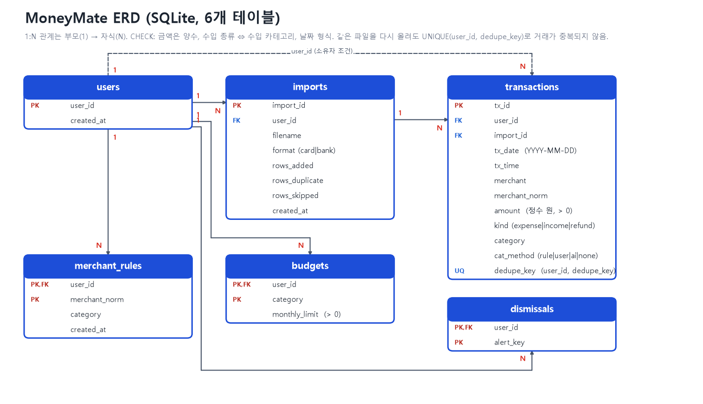
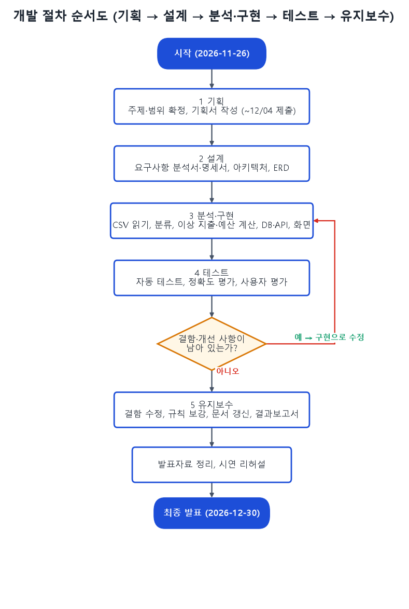
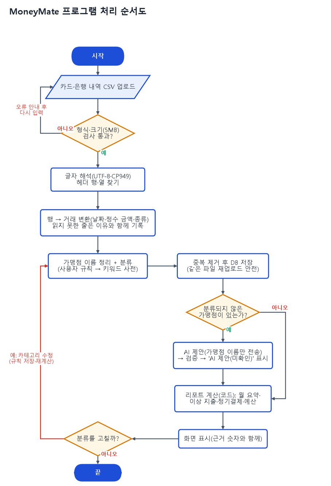

# MoneyMate 프로젝트 기획서

작성일 2026-11-26 · 작성자 반재영 · 제출 2026-12-04 · 최종 발표 2026-12-30 · 과정: 인공지능 응용 시스템 개발 종합 프로젝트

## 1. 프로젝트 개요

| 항목 | 내용 |
|---|---|
| 프로젝트명 | MoneyMate — 내 PC에서 처리하는 카드·은행 내역 분석 시스템 |
| 한 줄 소개 | 카드·은행 내역 CSV를 올리면 **자동으로 분류**하고, **중복 결제·유난히 큰 지출·정기결제 변동**을 근거 숫자와 함께 알려주며 **예산 초과를 미리 경고**합니다. 금액은 AI가 아니라 코드가 계산합니다. |
| 핵심 기술 | CSV 파싱 · 키워드 사전 분류 · 로버스트 통계(중앙값·MAD) 이상 탐지 · 로컬 LLM(Ollama) 분류 제안 + 검증 · Node.js 24 · SQLite |
| 개발 형태 | 개인 프로젝트(1인), 외부 npm 패키지 0개 |

## 2. 개발 배경과 목적

### 2.1 문제
1. **내 돈이 어디로 가는지 모름**: 카드 앱의 내역은 시간순 목록이라 "이번 달 식비가 왜 늘었는지", "언제부터 구독이 늘었는지"를 알기 어렵습니다.
2. **이상한 결제를 놓침**: 중복 결제, 갑자기 오른 구독료, 모르는 가게의 큰 결제는 목록 속에 묻힙니다.
3. **금융 정보의 민감성**: 가계부 앱·AI 서비스는 소비 내역을 외부 서버로 보내야 하고, 가맹점·금액은 생활 패턴을 그대로 드러냅니다.
4. **AI 분석의 신뢰 문제**: 생성형 AI에게 "이번 달 얼마 썼어?"를 물으면 합계를 틀리게 말하면서도 그럴듯합니다. 돈 계산은 1원이라도 틀리면 쓸모가 없습니다.

### 2.2 목표
- 내역 파일을 PC 밖으로 보내지 않고, 원본 CSV는 저장하지 않는다(정리된 거래만 보관).
- **모든 금액·합계·경고 문장의 숫자는 코드가 정수로 계산**하고, 경고에는 근거 숫자(중앙값·배수·비교 거래 수)를 붙인다.
- AI는 "사전에 없는 가맹점의 카테고리 제안" 하나만 맡기고, 가맹점 **이름만** 보내며(금액 제외), 결과는 검증 후 "AI 제안(미확인)"으로 표시한다. 미확인 분류가 지출에서 차지하는 비율을 항상 보여준다.
- AI·인터넷이 없어도 모든 핵심 기능이 동작한다.
- 측정한 정확도와 한계를 **있는 그대로** 문서화한다(가상 데이터는 가상이라고 표시).

## 3. 사용자와 시나리오

| 사용자 | 상황 | MoneyMate 사용 |
|---|---|---|
| 사회초년생·대학생 | 월급·용돈이 어디로 새는지 모름 | 카드 CSV 업로드 → 카테고리별 지출·전월 대비 → 예산 설정 |
| 구독이 많은 사람 | 안 쓰는 구독·가격 인상을 놓침 | 정기결제 목록·"금액 변동" 경고 |
| 금융 정보를 밖에 보내기 싫은 사람 | 클라우드 가계부 불안 | 로컬 처리, 원본 파일 비저장, AI에 금액 미전송 |

**시나리오**: 카드사 사이트에서 10월 이용내역 CSV를 내려받아 올린다 → "새 거래 293건, 분류되지 않은 가맹점 2곳" → 월 리포트에서 "OO한우 고깃집 380,000원은 '식비' 평소 금액(중앙값 17,880원)의 21.3배", "Netflix 17,000원 → 21,250원(+25%)", "요기요 17,880원이 2번 결제"를 확인 → 정상 지출은 "숨기기" → 미분류 가맹점은 AI 제안을 받아 확인하거나 직접 고침(같은 가맹점 전체에 적용) → 카테고리별 예산을 넣고 초과 여부 확인.

## 4. 주요 기능

| 구분 | 기능 | 설명 |
|---|---|---|
| 입력 | CSV 가져오기 | 카드(이용금액)·은행(출금/입금/잔액) 형식 자동 인식, UTF-8·CP949, 안내 문구·합계 줄 건너뜀, 읽지 못한 줄은 줄 번호와 이유 보고 |
| 변환 | 정수 금액·종류 | 금액은 정수 원, 종류는 지출·수입·환불(취소). 같은 파일을 다시 올려도 중복되지 않음 |
| 분류 | 자동 분류 | 가맹점 이름 정리("스타벅스 강남역점"="스타벅스") → 사용자 규칙 → 키워드 사전 → 미분류 |
| 교정 | 분류 고치기 | 한 번 고치면 같은 가맹점의 모든 거래와 앞으로의 가져오기에 적용 |
| AI | 분류 제안 | 사전에 없는 가맹점의 카테고리를 로컬 LLM이 제안, 검증 후 "AI 제안(미확인)", 사용자가 확인해야 확정 |
| 분석 | 월 리포트 | 지출·수입·전월 대비·카테고리별·일별·상위 가맹점·미확인 분류 비율 |
| 탐지 | 이상 지출 | 중복 결제 의심 · 카테고리 평소의 3배 넘는 지출 · 처음 보는 가맹점의 고액 · 정기결제 금액 변동 (모두 근거 숫자 표시, 정상이면 숨기기) |
| 구독 | 정기결제 | 25~35일 간격 3회 이상·금액이 거의 같은 결제 자동 발견, 월 합계 |
| 예산 | 예산 경고 | 카테고리별 월 예산, 초과·"이 속도면 월말에 초과" 예상 |
| 관리 | 내보내기·삭제 | 월 리포트(.md), 가져온 파일 단위 삭제, 「내 기록 모두 삭제」 |

## 5. 시스템 설계 개요

### 5.1 아키텍처

```
브라우저(public/)  ──HTTP──▶  http.mjs  ──▶  app.mjs(가져오기·리포트·분류 수정)
  가져오기·리포트·거래·예산     검증·제한·보안헤더      │
                                                   ├─ csv.mjs       글자 해석·CSV 파싱
                                                   ├─ ledger.mjs    행 → 거래(날짜·정수 금액·종류)
                                                   ├─ merchant.mjs  가맹점 이름 정리·키워드 분류
                                                   ├─ analyze.mjs   요약·이상 지출·정기결제·예산
                                                   ├─ ai.mjs        AI 분류 제안 + 검증
                                                   ├─ llm.mjs       Ollama / Claude / ChatGPT 어댑터
                                                   └─ db.mjs        SQLite 6개 테이블
```

- **http 층**: 본문 크기 제한(413), 텍스트 아닌 파일 거부(415), 사용자별 호출 간격(429), 경로 이탈 차단, CSP 헤더, 오류는 일반 문구만 노출, 127.0.0.1에서만 열림.
- **app 층**: 가져오기는 동기 처리(7,708건 기준 0.26초), AI 제안만 별도 호출(수십 초).
- **화면**: 가맹점 이름 같은 서버 글은 전부 `textContent`로만 출력(HTML이 들어 있어도 실행되지 않음).

### 5.2 분류 — 규칙 우선, AI는 제안만
1. **가맹점 이름 정리**: 소문자화, `(주)`·결제대행 접두어(카카오페이* 등)·지점명("강남역점")·끝 번호 제거 → 같은 가맹점으로 묶음.
2. **사용자 규칙**(내가 고친 가맹점) → **키워드 사전**(가장 긴 키워드 우선: "쿠팡"=쇼핑, "쿠팡이츠"=식비, "쿠팡와우"=구독) → 미분류(기타).
3. 규칙이 분류한 것은 AI가 건드리지 않는다. AI는 **미분류 가맹점의 이름만** 받아(금액·날짜 없음) 카테고리를 제안하고, 코드는 "물어본 가맹점인가, 정해진 카테고리 목록 안인가, 기타·수입이 아닌가, 중복이 아닌가"로 걸러낸다.
4. AI가 맞힌 분류도 "AI 제안(미확인)"으로 표시되고, 사용자가 "확인"을 눌러야 규칙이 된다. 리포트 상단에 **미확인 분류가 지출에서 차지하는 비율**을 항상 표시한다.

### 5.3 이상 지출 탐지 — 설명할 수 있는 규칙 4개
| 유형 | 조건 |
|---|---|
| 중복 결제 의심 | 같은 가맹점·같은 금액이 같은 날 2번 이상(시각이 있으면 10분 이내). 5천원 이상, 교통 제외 |
| 유난히 큰 지출 | 같은 카테고리의 `중앙값 + 5×MAD`를 넘고, 중앙값의 3배 이상이며 3만원 이상(거래 8건 미만·미분류는 고정비를 뺀 전체 지출과 비교하되 20만원·5배로 더 엄격). 평균·표준편차는 큰 값 하나에 끌려가 쓰지 않음 |
| 처음 보는 가맹점 | 과거 28일 이상 데이터가 있고, 처음 나온 가맹점에서 15만원 이상 |
| 정기결제 금액 변동 | 매달 같던 결제가 10% 이상 바뀜 |

월세·통신비 같은 고정비('주거·통신', '금융')는 원래 금액이 크므로 큰 지출 검사에서 제외합니다. 한 거래에 경고는 최대 1개이며, 각 경고에 근거 숫자(중앙값·배수·비교 거래 수)가 붙습니다.

### 5.4 데이터 설계
테이블 6개: users, imports, transactions, merchant_rules, budgets, dismissals. `transactions`는 금액 > 0, 종류·카테고리 목록, "수입 종류 ⇔ 수입 카테고리", 날짜 형식을 DB의 CHECK로 강제하고, `UNIQUE(user_id, dedupe_key)`로 같은 파일을 다시 올려도 중복되지 않게 합니다. 모든 데이터는 사용자 삭제 시 연쇄 삭제됩니다.



### 5.5 API
`POST /api/import`(CSV 본문) · `GET /api/report`·`/transactions`·`/export` · `POST /api/transactions/category`·`/classify/ai`·`/budgets`·`/alerts/dismiss`·`/alerts/restore`·`/imports/delete`·`/forget` · `GET /api/status`·`/sample`·`/stats` (상세는 요구사항 명세서 3장).

### 5.6 개발 절차 순서도



### 5.7 프로그램 처리 순서도



## 6. 활용 기술과 선택 이유

| 기술 | 선택 이유 |
|---|---|
| 키워드 사전 분류 | 결과가 항상 같고 "왜 그 카테고리인지" 설명 가능, 오프라인 동작, 규칙이 낸 분류는 틀리지 않음(실측 정밀도 100%) |
| 중앙값·MAD 이상 탐지 | 평균·표준편차는 큰 값 하나가 기준 자체를 끌어올려 이상치를 놓침. 설명 가능하고 학습 데이터가 필요 없음 |
| 정수 원 + 코드 계산 | 부동소수점·AI 환각 없이 합계가 정확. 모든 경고 문장의 숫자를 코드가 생성 |
| 로컬 LLM(Ollama kanana2:3b) | 사전에 없는 가맹점 이름의 카테고리 제안(이름만 전송). 외부 전송 없음, Claude·ChatGPT로 교체 가능한 어댑터 |
| 검증 + "미확인" 표시 | 3B 모델 제안의 정밀도가 56%라 그대로 믿으면 안 됨 → 걸러내고, 확정은 사람이 |
| Node.js 24 + node:sqlite | 외부 패키지 없이 `node server.mjs` 한 줄로 실행 |

## 7. 평가 계획

평가는 **세 층**으로 나누고, 평가 세트로 규칙을 고치지 않도록 세트를 구분합니다. 모든 결과는 「테스트 결과서」에 있습니다.

| 층 | 방법 | 현재 결과(2026-11-26) |
|---|---|---|
| 자동 테스트 | 파싱·부호·날짜·분류·이상 탐지·예산·AI 검증·보안·DB 제약 + 변이 검사 | 36/36 통과, 핵심 로직 12곳 변이 12곳 모두 검출(처음 11/12 → 놓친 곳의 테스트 추가) |
| 읽기·분류·이상 탐지 | 가상 거래내역(3개 형식, 세트당 약 880건)에서 정답과 비교. 개발용 / 1라운드 / 최종(held-out 2) 세트 분리 | 최종 세트: 읽기 100%(891/891), 분류 60.0%(규칙이 분류한 것의 정밀도 100%), 이상 지출 정밀도·재현율 100%(15/15, 오탐 0) |
| AI 분류 제안 | 최종 세트에서 규칙이 분류하지 못한 가맹점 17곳을 로컬 LLM에 질의 | 16곳 제안, 9곳 정답(제안 정밀도 56.3%) → 그래서 "미확인" 표시 필수 |
| 실제 평가(예정) | 12/08~12/19 본인·지인의 실제 카드 내역(동의·익명화), 사용자 3~5명 | 미실시 |

**측정에서 발견한 것(설계에 반영)**
1. 새 가맹점·금액대의 세트에서 분류 정확도가 68.1%로 떨어지고 이상 탐지 정밀도가 55%였다 → 원인은 분류 실패가 이상 탐지로 번지는 것(미분류 '기타'에 서로 다른 가게가 섞여 기준이 무너짐) → "미분류·표본 부족은 전체 지출과 비교하되 더 엄격하게"로 수정.
2. 사전 보강 후의 새 세트(최종)에서도 분류는 60%였다 → **키워드 사전은 처음 보는 가게를 못 맞힌다**는 것을 인정하고, 사용자 교정(가맹점 단위로 기억)과 AI 제안(미확인 표시)을 정식 기능으로 설계.
3. 이상 탐지의 15만원·20만원 기준은 절대값이라, 소비 규모가 큰 세트에서는 평범한 새 가게 지출(204,000원)이 경고로 잡혔다(오탐). 최종 세트에서는 오탐이 없었지만 기준값 영향이므로 한계로 기록.

**한계**: 모든 평가 데이터는 직접 만든 가상 거래내역이라 실제보다 단순하다(정기결제가 정확히 매달 같은 날, 가맹점 수가 적음). 정확도는 상한선에 가깝다. 실제 카드사 CSV의 열 이름·형식 변형은 12월에 확인한다.

## 8. 개발 단계와 일정

| 단계 | 기간 | 산출물 | 상태(2026-11-26) |
|---|---|---|---|
| 1 기획 | 11/26~12/04 | 기획서(본 문서) | 작성 완료, 제출 12/04 |
| 2 설계 | 11/26~11/29 | 요구사항 분석서·명세서, ERD, 순서도 | 초안 완료 |
| 3 분석·구현 | 11/26~12/08 | CSV 읽기·분류·분석·API·화면 | 핵심 구현 완료 |
| 4 테스트 | 11/26~12/19 | 자동 테스트, 정확도 평가, 실제 내역·사용자 평가 | 자동 테스트·1차 평가 완료, 실제 평가 예정 |
| 5 유지보수 | 12/15~12/24 | 개선, 결과보고서 | 예정 |
| 마무리 | 12/22~12/30 | 발표자료·시연 | 초안 완료, 발표 12/30 |

세부 일정은 「개발일정표」 참조.

## 9. 위험과 대응

| 위험 | 대응 |
|---|---|
| 처음 보는 가맹점은 분류되지 않음(실측 60%대) | 사용자 교정(가맹점 단위 기억) + AI 제안(미확인 표시) + 미확인 비율 상시 표시 |
| 카드사마다 CSV 형식이 다름 | 열 이름 별칭 표·헤더 자동 탐색·읽지 못한 줄 보고. 12월에 실제 CSV 3종 이상으로 확인 |
| 3B AI 제안의 정밀도 56% | 검증 관문, "AI 제안(미확인)" 표시, 사용자 확인 후에만 규칙 확정 |
| 이상 탐지 기준값이 소비 규모에 민감 | 근거 숫자를 항상 표시, "정상이에요(숨기기)", 기준값을 한계로 문서화 |
| 실제 가계부는 가상 데이터보다 복잡 | 가상 데이터 수치는 상한선으로만 해석, 12월에 실제 평가 |
| 로그인 없음 | 127.0.0.1 바인딩, 한계로 명시(다중 사용자 배포 시 인증 필요) |

## 10. 기대 효과와 확장

- **효과**: 소비 패턴 파악, 중복·이상 결제와 구독 인상 조기 발견, 금융 정보를 밖으로 보내지 않는 분석, AI 결과를 검증 가능한 형태로 제공.
- **확장**: 카드사별 CSV 템플릿 확대, 엑셀(.xlsx) 직접 읽기, 월별 추세·카테고리 예측, 더 큰 모델·Claude·ChatGPT 분류 제안 실측, 로그인·권한.
