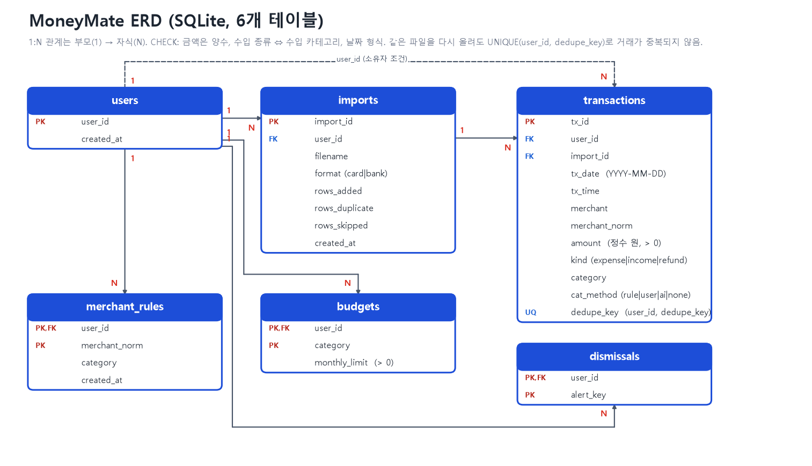

# MoneyMate 데이터정의서

작성일 2026-11-26 · 작성자 반재영 · 버전 1.0 · DBMS: SQLite(Node.js 내장 `node:sqlite`) · 구현: `src/db.mjs`

## 1. ERD

- 1:N 관계는 부모 → 자식. 모든 데이터 테이블이 `users`에 ON DELETE CASCADE로 연결되어, 사용자 삭제 한 번으로 모든 기록이 지워집니다.
- `transactions`는 `imports`(가져온 파일 한 번)에도 ON DELETE CASCADE로 연결되어, 가져온 파일을 삭제하면 그 파일의 거래가 함께 지워집니다.
- DB가 데이터 규칙을 직접 강제합니다: 금액 > 0, 종류·분류 방법·카테고리는 정해진 값만, **수입 종류 ⇔ '수입' 카테고리**, 날짜 형식, 같은 파일 재업로드 중복 방지.

## 2. 테이블 목록

| 테이블 | 설명 | 주요 관계 |
|---|---|---|
| users | 익명 사용자(브라우저가 만든 난수 ID) | 1:N imports, transactions, merchant_rules, budgets, dismissals |
| imports | 가져오기 한 번(파일 이름·형식·추가/중복/제외 건수) | N:1 users, 1:N transactions |
| transactions | 정리된 거래: 날짜·가맹점·정수 금액·종류·카테고리·분류 방법 | N:1 users, imports |
| merchant_rules | 사용자가 고친 가맹점 → 카테고리 규칙 | N:1 users |
| budgets | 카테고리별 월 예산 | N:1 users |
| dismissals | 사용자가 "정상이에요"로 숨긴 경고 | N:1 users |

## 3. 테이블 정의

### 3.1 users
| 컬럼 | 타입 | 키 | NULL | 설명 |
|---|---|---|---|---|
| user_id | TEXT | PK | N | 익명 ID(`u-` + 난수 24자). 이름·연락처는 받지 않음 |
| created_at | TEXT | | N | 생성 시각(ISO 8601) |

### 3.2 imports
| 컬럼 | 타입 | 키 | NULL | 설명 |
|---|---|---|---|---|
| import_id | INTEGER | PK(자동증가) | N | 가져오기 번호 |
| user_id | TEXT | FK→users | N | 소유자 |
| filename | TEXT | | N | 파일 이름(경로 문자·제어문자 제거, 최대 80자). 파일 내용은 저장하지 않음 |
| format | TEXT | CHECK | N | `card` 또는 `bank` |
| rows_added | INTEGER | | N | 새로 저장된 거래 수 |
| rows_duplicate | INTEGER | | N | 이미 있어 건너뛴 거래 수 |
| rows_skipped | INTEGER | | N | 읽지 못해 제외한 줄 수 |
| created_at | TEXT | | N | 가져온 시각 |

### 3.3 transactions
| 컬럼 | 타입 | 키 | NULL | 설명 |
|---|---|---|---|---|
| tx_id | INTEGER | PK(자동증가) | N | 거래 번호 |
| user_id | TEXT | FK→users | N | 소유자. 조회·수정 시 항상 함께 조건으로 사용 |
| import_id | INTEGER | FK→imports | N | 가져온 파일 |
| tx_date | TEXT | CHECK | N | 거래일 YYYY-MM-DD(GLOB 형식 검사) |
| tx_time | TEXT | | Y | 시각 HH:MM(파일에 있을 때만). 중복 결제 판단에 사용 |
| merchant | TEXT | | N | 원본 가맹점·적요(제어문자 제거, 최대 60자) |
| merchant_norm | TEXT | | N | 정리된 가맹점 키(같은 가게를 묶는 기준) |
| amount | INTEGER | CHECK >0 | N | 금액(정수 원). 소수·0·음수는 저장 불가 |
| kind | TEXT | CHECK | N | `expense` 지출 · `income` 수입 · `refund` 취소/환불 |
| category | TEXT | CHECK | N | 식비·카페·마트·편의점·교통·주거·통신·쇼핑·의료·건강·문화·여가·구독·교육·금융·기타·수입 |
| cat_method | TEXT | CHECK | N | `rule` 사전 · `user` 사용자 · `ai` AI 제안(미확인) · `none` 미분류 |
| dedupe_key | TEXT | UQ(user_id, dedupe_key) | N | 날짜·시각·가맹점·금액·종류·같은 파일 안 순번의 SHA-1. 재업로드 중복 방지 |

추가 제약: `CHECK ((kind = 'income') = (category = '수입'))` — 수입 거래는 '수입'이고, 그 반대도 성립해야 저장됩니다.

### 3.4 merchant_rules
| 컬럼 | 타입 | 키 | NULL | 설명 |
|---|---|---|---|---|
| user_id | TEXT | PK, FK→users | N | 소유자 |
| merchant_norm | TEXT | PK | N | 가맹점 키 |
| category | TEXT | CHECK(지출 카테고리) | N | 사용자가 정한 카테고리 |
| created_at | TEXT | | N | 생성 시각 |

### 3.5 budgets
| 컬럼 | 타입 | 키 | NULL | 설명 |
|---|---|---|---|---|
| user_id | TEXT | PK, FK→users | N | 소유자 |
| category | TEXT | PK, CHECK(지출 카테고리) | N | 예산 대상 카테고리 |
| monthly_limit | INTEGER | CHECK >0 | N | 월 예산(정수 원) |

### 3.6 dismissals
| 컬럼 | 타입 | 키 | NULL | 설명 |
|---|---|---|---|---|
| user_id | TEXT | PK, FK→users | N | 소유자 |
| alert_key | TEXT | PK | N | 경고 식별 문자열(`유형:가맹점키:날짜:금액`). 거래 번호가 아니라 내용 기반이라 다시 가져와도 유지 |

## 4. 인덱스

| 인덱스 | 대상 | 용도 |
|---|---|---|
| ix_tx_user_date | transactions(user_id, tx_date) | 월별 조회·정렬 |
| ix_tx_user_norm | transactions(user_id, merchant_norm) | 같은 가맹점 일괄 분류·미분류 집계 |
| (자동) UNIQUE | transactions(user_id, dedupe_key) | 중복 방지 |

## 5. 데이터 관리 정책

| 항목 | 정책 |
|---|---|
| 원본 파일 | 저장하지 않음(정리된 거래만 보관) |
| AI로 나가는 정보 | 미분류 가맹점의 **이름만**. 금액·날짜·건수는 보내지 않음 |
| 금액 표현 | 정수 원만 사용(부동소수점 없음). 합계·증감·경고 문장의 숫자는 코드가 계산 |
| 소유자 격리 | 모든 조회·수정 함수가 userId를 함께 받아 조건에 포함. 남의 데이터는 존재하지 않는 것처럼 404 |
| 가져오기 원자성 | 한 파일의 가져오기는 트랜잭션으로 전부 성공하거나 전부 롤백 |
| 삭제 | 가져온 파일 단위 삭제, 「내 기록 모두 삭제」(확인 필수). 연쇄 삭제로 모든 표가 비워짐 |
| 보존 기간 | 사용자가 지우기 전까지 보관(로컬 파일 `data/moneymate.db`, git에 올라가지 않음) |
| 개인정보 | 이름·연락처·계좌번호는 받지 않음. 가맹점 문자열에 포함된 내용은 그대로 저장되므로 DB 파일 자체를 보호해야 함 |
