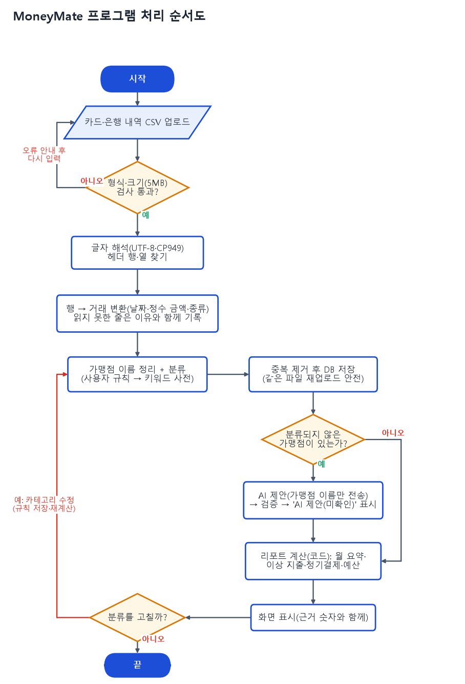

# MoneyMate 요구사항 분석서

작성일 2026-11-26 · 작성자 반재영 · 버전 1.0

## 목차
1. 개요 · 2. 시스템 범위와 이해관계자 · 3. 현황 분석과 문제 정의 · 4. 사용자 요구 분석 · 5. 기능 요구사항 분석 · 6. 비기능 요구사항 분석 · 7. 제약 사항과 가정 · 8. 유스케이스 · 9. 우선순위 · 10. 추적성 · 11. 위험 분석

## 1. 개요

### 1.1 목적
카드·은행 내역을 자동으로 분류하고 이상 지출·예산 초과를 알려주는 MoneyMate의 요구사항을 분석하고, 구현·시험의 기준으로 삼는다.

### 1.2 시스템 개요
사용자가 카드사·은행에서 내려받은 CSV를 올리면, 시스템이 거래로 변환·분류하고 월별 요약, 이상 지출, 정기결제, 예산 상태를 계산해 보여준다. 모든 처리는 사용자의 PC에서 이루어지며, AI(로컬 LLM)는 사전에 없는 가맹점의 카테고리 제안에만 쓰인다.

### 1.3 용어
| 용어 | 뜻 |
|---|---|
| 거래 | 날짜·가맹점·금액·종류를 가진 한 줄의 내역 |
| 종류(kind) | expense 지출 · income 수입 · refund 취소/환불(지출에서 차감) |
| 가맹점 키 | 지점명·결제대행·(주)·번호를 지운 가맹점 이름(같은 가게를 하나로 묶는 기준) |
| 분류 방법(cat_method) | rule 키워드 사전 · user 사용자가 고침/확인 · ai AI 제안(미확인) · none 미분류 |
| 미확인 분류 | 분류 방법이 ai 또는 none인 지출 |
| MAD | 중앙값 절대 편차. 이상치에 덜 흔들리는 산포 지표 |
| 중복 제거 키(dedupe key) | 날짜·시각·가맹점·금액·종류·같은 파일 안 순번의 해시. 같은 파일 재업로드를 막음 |

## 2. 시스템 범위와 이해관계자

| 구분 | 내용 |
|---|---|
| 범위 안 | CSV 가져오기, 거래 변환, 자동 분류와 교정, AI 분류 제안, 월 리포트, 이상 지출 탐지, 정기결제, 예산, 내보내기, 삭제 |
| 범위 밖 | 은행·카드 계좌 연동(오픈뱅킹), 엑셀(.xlsx) 직접 읽기, 로그인·다중 사용자 배포, 투자·자산 관리, 모바일 앱 |

| 이해관계자 | 관심사 |
|---|---|
| 사용자(개인) | 소비 파악, 이상 결제 발견, 금융 정보 보호 |
| 개발자(본인) | 정확한 계산, 검증 가능한 AI 사용, 유지보수 |
| 평가자(강사) | 요구사항–설계–시험의 일관성, 측정 결과의 정직성 |

## 3. 현황 분석과 문제 정의

| 현황 | 문제 | MoneyMate의 대응 |
|---|---|---|
| 카드 앱은 시간순 목록 중심 | 카테고리별·전월 대비 파악이 어려움 | 월 리포트(카테고리·전월 대비·일별) |
| 이상 결제는 목록 속에 묻힘 | 중복 결제·구독 인상을 놓침 | 4가지 규칙 탐지 + 근거 숫자 |
| 가계부 앱은 클라우드 기반 | 소비 내역이 외부로 나감 | 로컬 처리, 원본 파일 비저장 |
| 생성형 AI에게 합계를 물으면 틀림 | 돈 계산 신뢰 불가 | 금액은 정수·코드 계산, AI는 분류 제안만 |
| 가맹점 이름이 제각각 | "스타벅스 강남역점/서초점"이 다른 가게로 보임 | 가맹점 키로 묶음 |

## 4. 사용자 요구 분석

| ID | 사용자 요구 |
|---|---|
| UN-01 | 내려받은 CSV를 그대로 올리면 알아서 읽어 주길 원한다(카드사·은행마다 형식이 다름) |
| UN-02 | 같은 파일을 실수로 다시 올려도 거래가 두 배가 되지 않길 원한다 |
| UN-03 | 카테고리가 자동으로 붙고, 틀린 건 한 번만 고치면 되길 원한다 |
| UN-04 | 합계·증감이 1원도 틀리지 않길 원한다 |
| UN-05 | 중복 결제·평소보다 큰 지출·구독 인상을 알려 주되 **왜 그런지 숫자로** 보여 주길 원한다 |
| UN-06 | 카테고리별 예산을 정하고, 넘기기 전에 경고받길 원한다 |
| UN-07 | AI가 분류한 것은 AI가 한 것임을 알고, 내가 확인할 수 있길 원한다 |
| UN-08 | 내 소비 내역이 외부로 나가지 않길 원한다 |
| UN-09 | 못 읽은 줄이 있으면 조용히 빠지지 않고 알려 주길 원한다 |
| UN-10 | 기록을 언제든 지울 수 있길 원한다 |

## 5. 기능 요구사항 분석

| 영역 | 요구 | 핵심 판단 |
|---|---|---|
| 입력 | CSV 형식 자동 인식·인코딩·한도 | 헤더 별칭 표로 열을 찾고, 앞쪽 안내 문구는 건너뛴다. 카드와 은행은 금액 부호 의미가 다르다(잔액 열이 있으면 은행) |
| 변환 | 정수 금액, 날짜 검증, 종류 | 소수·문자·0원은 거부하고 줄 번호·이유를 보고한다 |
| 중복 | 재업로드 안전 | 같은 날 같은 가게의 같은 금액 두 건은 정상일 수 있으므로 "같은 파일 안 순번"을 키에 포함 |
| 분류 | 규칙 → AI 제안 → 사람 확인 | 규칙은 설명 가능·정밀(실측 100%), 재현율이 낮아(실측 58%) 교정·AI 제안이 필요 |
| 탐지 | 설명 가능한 규칙 4개 | 평균이 아니라 중앙값·MAD. 근거 숫자 표시, 숨기기 지원 |
| 예산 | 초과·월말 예상 | 이번 달은 일할 속도로 예상(7일 이상 지난 뒤부터) |
| 개인정보 | 로컬·최소 전송 | AI에는 가맹점 이름만 전송, 금액·날짜 제외 |

## 6. 비기능 요구사항 분석

| 분류 | 요구 |
|---|---|
| 정확성 | 모든 금액은 정수 원, 합계·증감은 코드가 계산 |
| 가용성 | AI·인터넷 없이도 가져오기·분류·분석·예산이 모두 동작 |
| 개인정보 | 원본 CSV 비저장, 로컬 처리, AI에 금액 미전송, 127.0.0.1에서만 열림 |
| 보안 | 소유자 조건(IDOR), 크기·형식·호출 간격 제한, CSP, HTML 무해화 |
| 신뢰성 | 가져오기는 전부 성공하거나 전부 취소(트랜잭션), 오류는 일반 문구 |
| 정직성 | AI 제안은 "미확인" 표시, 미확인 지출 비율 상시 표시 |
| 성능 | 7,708건 가져오기 1초 이내, 월 리포트 0.1초 안팎 |
| 이식성·유지보수 | Node.js 24만으로 실행, 모든 소스에 "무엇을·왜" 주석, 자동 테스트 |

## 7. 제약 사항과 가정

- 개인 프로젝트(1인), 기획서 12/04·발표 12/30. 외부 npm 패키지 없이 Node.js 24 내장 기능만 사용.
- 평가용 거래내역은 실제 카드 내역(개인정보)을 쓸 수 없어 **직접 만든 가상 데이터**(시드 고정, 정답 포함)를 사용한다 → 실제보다 단순하므로 정확도는 상한선으로 해석.
- 로컬 LLM은 3B급(kanana2:3b)이라 제안 품질이 낮다. 큰 모델·Claude·ChatGPT는 측정하지 못했다.
- 사용자 평가는 본인·지인 3~5명(12/08~12/19 예정).

## 8. 유스케이스

| ID | 유스케이스 | 주 흐름 | 예외 |
|---|---|---|---|
| UC-01 | 내역 가져오기 | 파일 선택 → 가져오기 → 새 거래·중복·제외 줄 건수 표시 | 415 텍스트 아님, 413 5MB 초과, 400 거래표 없음 |
| UC-02 | 월 리포트 보기 | 월 선택 → 요약·확인할 지출·예산·카테고리·정기결제 | 데이터 없음 안내 |
| UC-03 | 분류 고치기 | 거래 내역 → 카테고리 변경 → 같은 가맹점 전체 적용 | 수입 거래는 변경 불가(404) |
| UC-04 | AI 분류 제안 | 버튼 → 미분류 가맹점 이름만 전송 → "AI 제안(미확인)" → 확인 | AI 없음 503 |
| UC-05 | 이상 지출 확인 | 경고의 근거 숫자 확인 → 정상이면 숨기기 → 필요하면 다시 보기 | – |
| UC-06 | 예산 관리 | 카테고리별 월 예산 입력·삭제 → 리포트에서 초과·예상 | 0원·소수 400 |
| UC-07 | 삭제 | 가져온 파일 단위 삭제 / 내 기록 모두 삭제(확인창) | confirm 없으면 400 |

### 8.1 처리 순서도

## 9. 요구사항 우선순위 (MoSCoW)

| 구분 | 요구사항 |
|---|---|
| Must | FR-01~05, 07·08·10·11·12, NFR-01·03·04·05·06 |
| Should | FR-06(AI 제안), 09(정기결제), 13(내보내기), 14(거래 목록), NFR-02·07·08 |
| Could | 가져온 파일 단위 관리 화면, 일별 지출 막대 |
| Won't | 계좌 연동, 엑셀 직접 읽기, 로그인·권한, 모바일 앱 |

## 10. 추적성

| 사용자 요구 | 기능 요구 | 설계 요소 | 시험 |
|---|---|---|---|
| UN-01 | FR-01·02 | csv.mjs, ledger.mjs | CSV·변환 테스트, 3형식 평가 |
| UN-02 | FR-11 | dedupe_key, UNIQUE | 재업로드·순번 테스트 |
| UN-03 | FR-04·05 | merchant.mjs, merchant_rules | 분류·규칙 기억 테스트, 분류 평가 |
| UN-04 | FR-03·07 | 정수 금액, analyze.mjs | 요약·환불 차감 테스트 |
| UN-05 | FR-08·09 | detectAnomalies, findRecurring | 이상 탐지 테스트, 이상 평가 |
| UN-06 | FR-10 | budgetStatus | 예산 테스트 |
| UN-07 | FR-06 | ai.mjs, cat_method | AI 검증·미확인 비율 테스트 |
| UN-08 | NFR-03 | 로컬 처리, 이름만 전송 | AI 프롬프트에 금액 없음 테스트 |
| UN-09 | FR-03 | skipped 보고 | 줄 번호·이유 테스트 |
| UN-10 | FR-12 | CASCADE | 삭제 테스트 |

## 11. 위험 분석

| 위험 | 가능성 | 영향 | 대응 |
|---|---|---|---|
| 처음 보는 가맹점 분류 실패 | 높음(실측 분류 60%) | 카테고리 합계 왜곡 | 교정·AI 제안·미확인 비율 표시 |
| 실제 카드사 CSV 형식이 별칭 표에 없음 | 중간 | 가져오기 실패 | 거래표 못 찾으면 이유 안내, 12월 실제 CSV로 별칭 확대 |
| 3B AI의 틀린 제안 | 높음(정밀도 56%) | 잘못된 카테고리 | 검증 + 미확인 표시 + 사람 확인 |
| 이상 탐지 기준값이 소비 규모에 민감 | 중간 | 오탐·미탐 | 근거 숫자 표시, 숨기기, 한계 문서화 |
| 가상 데이터가 실제보다 쉬움 | 높음 | 정확도 과대평가 | 상한선으로 표기, 실제 평가 예정 |
