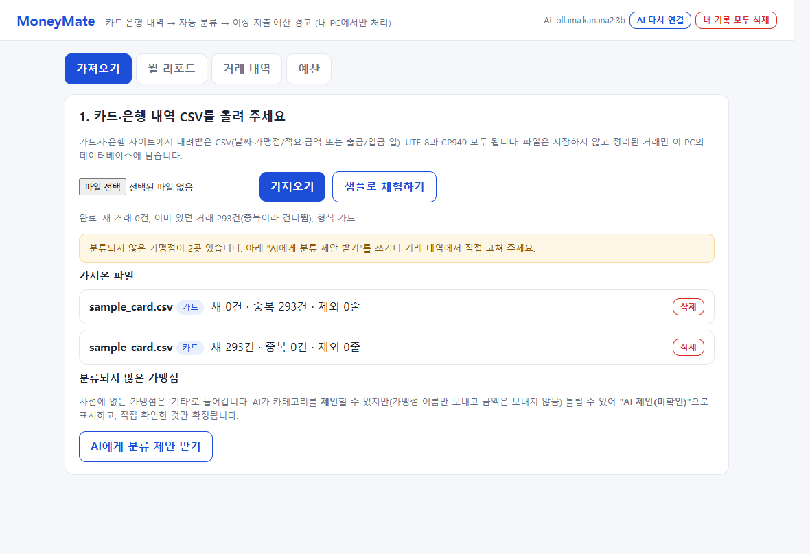
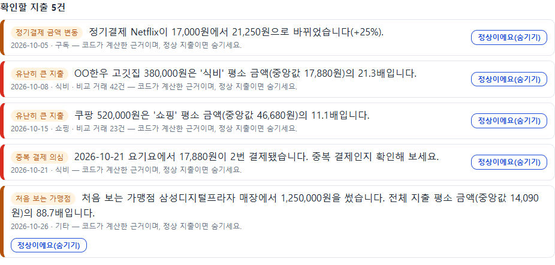
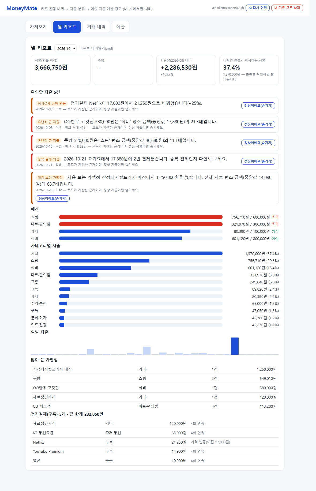
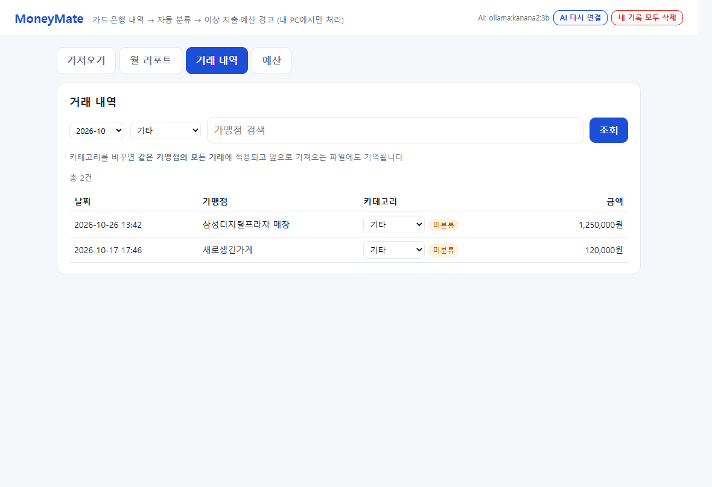
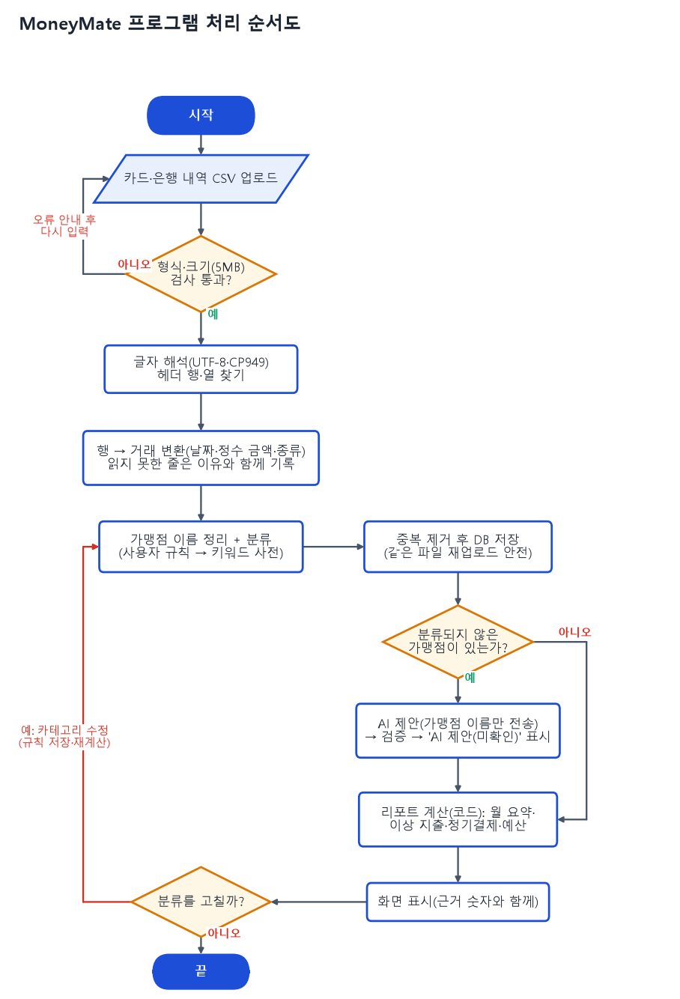
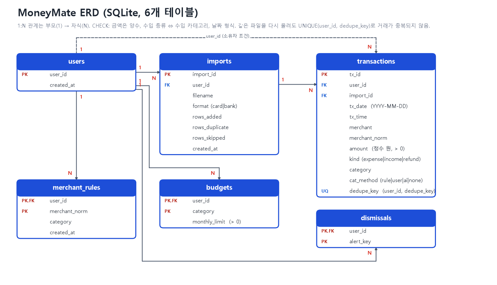

# 포트폴리오 — MoneyMate

## 한 줄 소개
카드·은행 내역 CSV를 **내 PC에서** 분석해 자동 분류하고, 중복 결제·유난히 큰 지출·구독 가격 변동을 **근거 숫자와 함께** 알려주며, 금액은 AI가 아니라 **코드가 정수로 계산**하는 가계부 분석 시스템.

## 프로젝트 정보
| 항목 | 내용 |
|---|---|
| 작성자 | 반재영 (개인 프로젝트, 기획·설계·구현·테스트·문서 전 과정) |
| 기간 | 2026.11.26 ~ 12.30 (기획서 12/04, 발표 12/30) |
| 기술 | Node.js 24, SQLite(node:sqlite), Ollama(kanana2:3b, 선택), 바닐라 JS, 외부 npm 패키지 0개 |
| 코드 | `projects/MoneyMate` (소스 약 1,300줄 + 테스트 36개, 모든 파일에 무엇을·왜 주석) |

## 문제와 해결
- **문제**: 카드 앱의 내역은 시간순 목록이라 이상 결제와 소비 패턴이 묻힌다. 클라우드 가계부는 소비 내역을 외부로 보내고, 생성형 AI는 합계를 틀리게 말하면서도 그럴듯하다.
- **해결**: CSV를 읽어 **정수 원** 거래로 변환 → 규칙 분류(처음 보는 가게는 사용자 교정·AI 제안) → 중앙값·MAD 이상 탐지 → 근거 숫자가 붙은 경고·예산 상태. AI는 사전에 없는 가맹점의 **이름만** 받아 카테고리를 제안하고, 결과는 "미확인"으로 표시.

## 핵심 성과
- **내역이 PC 밖으로 나가지 않음**: 원본 CSV 비저장, AI에는 가맹점 이름만 전송(금액 제외를 테스트로 확인).
- **합계 오차 0**: 모든 금액은 정수, 경고 문장의 숫자도 코드가 생성. 소수·문자·0원·존재하지 않는 날짜는 거부하고 **몇 번째 줄이 왜 제외됐는지** 보고.
- **DB가 규칙을 강제**: 금액>0, "수입 종류 ⇔ 수입 카테고리", 날짜 형식, `UNIQUE(user_id, dedupe_key)`로 같은 파일 재업로드 시 거래가 쌓이지 않음(같은 날 같은 가게 같은 금액의 정상 2건은 보존).
- 자동 테스트 36개, 핵심 로직 12곳을 망가뜨려 **12곳 모두 검출**(처음엔 11/12 — 놓친 곳의 테스트를 보강).
- **정직한 평가**: 개발용 100% → 새 세트 분류 68.1%로 하락을 확인하고 세트를 분리. 최종 새 세트: 읽기 100%, 분류 60.0%(규칙이 분류한 것의 정밀도 100%), 이상 지출 15/15·오탐 0, AI 제안 정밀도 56.3%.
- 성능: 7,708건 가져오기 0.26초, 월 리포트 0.08초.

## 화면
| 가져오기 | 월 리포트(확인할 지출 · 예산) |
|---|---|
|  |  |

| 월 리포트 전체 | 거래 내역(미분류 가맹점 교정) |
|---|---|
|  |  |

## 아키텍처·데이터

## 내가 한 기술적 선택과 이유
| 선택 | 이유 |
|---|---|
| 키워드 사전 + 사용자 교정 + AI 제안(미확인) | 규칙은 설명 가능하고 틀리지 않지만(정밀도 100%) 처음 보는 가게는 못 맞힘(재현율 58%) → 사람이 고치면 가맹점 단위로 기억, AI는 제안만 |
| 중앙값·MAD 이상 탐지 | 평균·표준편차는 큰 값 하나가 기준을 끌어올려 이상치를 놓침. 학습 데이터 없이 설명 가능 |
| 정수 원·코드 계산 | 부동소수점·AI 환각 차단. 경고 문장의 숫자가 전부 근거와 일치 |
| 미분류는 전체 지출과 비교하되 더 엄격하게 | 1라운드 측정에서 '기타'에 섞인 가게들이 기준을 무너뜨리는 것을 발견하고 수정 |
| 미확인 분류 비율 상시 표시 | AI 제안 정밀도가 56%라 "얼마나 믿어도 되는지"를 화면이 말해야 함 |
| 세트 분리 평가(개발용/held-out1/held-out2) | 같은 데이터로 만들고 재면 과대평가 → 실제로 100%→68% 하락 확인 |

## 측정으로 발견해 고친 것
1. 새 가맹점 세트에서 분류 68.1%, 이상 탐지 정밀도 55% → 분류 실패가 이상 탐지로 번진 것(미분류 '기타'의 기준 붕괴) → 전체 지출과 비교하되 기준 강화.
2. 사전을 보강해도 최종 새 세트에서 분류는 60% → 사전의 한계를 인정하고 교정·AI 제안을 정식 기능으로.
3. 테스트가 고정비(월세) 오경고 결함을 못 잡는 것을 변이 검사로 발견 → 테스트 추가.
4. 이상 탐지 기준(15만·20만원)이 절대 금액이라 소비 규모가 큰 세트에서 오탐 → 우연히 맞은 결과임을 문서에 명시.

## 배운 점과 한계
- "규칙이 틀리지 않는다"와 "규칙이 충분히 많이 맞힌다"는 다르다. 정밀도 100%·재현율 58%라는 두 숫자를 같이 봐야 한다.
- AI 출력은 **측정해 보기 전에는** 쓸 만한지 알 수 없다(56%). 그래서 확정은 사람이 하고 화면이 불확실성을 보여 준다.
- 평가 데이터는 가상이라 정확도는 상한선에 가깝다. 실제 카드사 CSV의 형식 변형, 로그인(현재 127.0.0.1에서만 열림), 소비 규모에 비례하는 기준값은 후속 과제.
- 12월: 실제(동의·익명화) 내역 평가, 더 큰 모델·Claude·ChatGPT로 AI 제안 재측정.

## 산출물
기획서 · 요구사항 분석서 · 요구사항 명세서 · 데이터정의서(ERD) · 순서도 2종 · 개발일정표 · 테스트 결과서 · 발표자료(PPTX·PDF) · 소스 코드 · 자동 테스트
